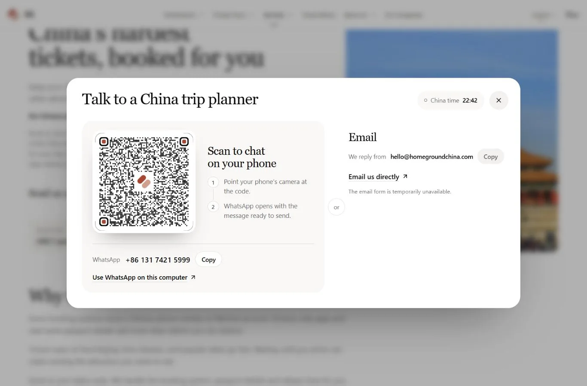

# Browser and policy QA

Latest full-page refinement (18 October): [seven-language captures](customer-focus-20261018/README.md) and the phone checks linked there supersede earlier wording. The public table now omits the channel column. EN/ZH/KO at 390×844 retain the correct fee totals and mobile notes/date layout without horizontal overflow. Policy tests and the production build pass after the refinement.

The EN, ZH and KO summary views were checked at 390×844 and 1366×900 with the privacy banner visible and dismissed. Recorded measurements report no horizontal overflow; actual screenshots show fee totals and send controls without clipping or banner overlap.

Initial hero text and CTAs can continue below the first fold or privacy banner. Vertical scrolling or dismissing the banner exposes lower content. Hero CTA visibility above the first fold is not an acceptance criterion.

The screenshot cases include different input selections: phone summary views and banner views show three travellers and two attractions; desktop clear views show two travellers and one attraction. DOM measurements and screenshots are recorded separately; use each visible formula when reviewing a photo.

[Browse the actual screenshots](index.html#privacy-qa) · [Inspect browser measurements](browser-qa-results.json)

## Policy regression coverage

The [policy regression tests](../../../supabase/tests/attraction-reservations-sales.test.mjs) check these requirements across all seven service editions:

- The guarantee cutoff remains eight days and requires both the request and payment. The owner removed the attraction-specific exclusion on 18 October; all offered attractions use the same guarantee.
- A failed guaranteed booking refunds the service fee and ticket money in full. A late request remains an attempt without a guarantee; failure refunds the service fee and ticket money not spent.
- The base fee remains CNY 45 per traveller per attraction, with tickets at official face value and no markup; payment follows written confirmation.
- Issued-ticket service fees retain their non-refundable condition. Unsuccessful guaranteed reservations retain the full refund of both amounts.
- Draft messages remain requests to book and retain selected attractions, visit dates, travellers and notes. Existing fields, tracking event names, current-draft CTA behavior and focus return are covered.

See the pull request validation notes for executed test results.

## Current-draft contact card

The current-draft contact card opens with a QR code, WhatsApp and email fallback. The local preview reports that its email form is temporarily unavailable. No message was sent.

