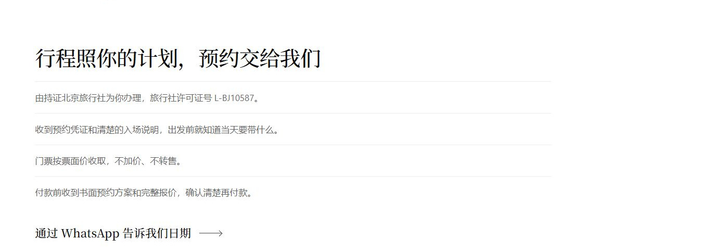

# Customer-focused reservation copy — 18 October 2026

This revision reduces explanations of internal booking methods throughout the attraction reservation service page and presents the same customer benefits and next steps in all seven editions.

The before preview is the local export of commit `58c3582a`. The after preview uses this revision's working-tree source. The 17 October gallery and earlier 18 October owner revision remain dated history; this folder records the subsequent customer-focused revision.

## Full-page comparisons

All 14 real browser captures open all nine city sections and all seven FAQs. Every changed paragraph can be reviewed in the complete page, including the attraction facts table and FAQ answers.

The JPEG copies retain each PNG's native pixel dimensions at quality 92 with no resizing or redrawing. The usual desktop content width is 1351px after excluding the 15px scrollbar from the recorded 1366px viewport. Arabic screenshots retain their full 1448px document width, including the pre-existing overflow.

| Edition | Source page | Before | After |
|---|---|---|---|
| English | `/services/china-attraction-reservations/` | [Full page · 1351×14182](en-before.jpg) | [Full page · 1351×12768](en-after.jpg) |
| Chinese | `/zh/services/china-attraction-reservations/` | [Full page · 1351×11888](zh-before.jpg) | [Full page · 1351×11572](zh-after.jpg) |
| Korean | `/ko/services/china-attraction-reservations/` | [Full page · 1351×12445](ko-before.jpg) | [Full page · 1351×11829](ko-after.jpg) |
| French | `/fr/services/china-attraction-reservations/` | [Full page · 1351×15439](fr-before.jpg) | [Full page · 1351×13976](fr-after.jpg) |
| Spanish | `/es/services/china-attraction-reservations/` | [Full page · 1351×15332](es-before.jpg) | [Full page · 1351×13745](es-after.jpg) |
| German | `/de/services/china-attraction-reservations/` | [Full page · 1351×15217](de-before.jpg) | [Full page · 1351×14203](de-after.jpg) |
| Arabic | `/ar/services/china-attraction-reservations/` | [Full page · 1448×13052](ar-before.jpg) | [Full page · 1448×12430](ar-after.jpg) |

## Chinese service benefits

This exact crop of the revised Chinese page shows the title and four service benefits, with a little surrounding whitespace. Its source PNG and pixel bounds are recorded in the metadata. The three-step sequence remains in the full-page image.

## Capture provenance and validation

[Capture manifest, source hashes and crop geometry](metadata.json). Metadata uses relative source filenames; original PNGs are retained outside the repository.

Validation confirms seven before/after pairs, native output dimensions, complete image files and matching hashes. The Chinese benefits crop was inspected at readable size. There are 15 JPEG images in this package, totaling 32.79 MB.

Recorded overflow is false for EN, ZH, KO, FR, ES and DE in both phases. Arabic overflow is true in both phases and is retained as the existing header/RTL issue; it is not introduced by this copy revision.

Capture limitation: the EN after source does not show the fixed header in its top 69px; its hero and service body through the footer are complete. This package does not certify navigation behavior.

These desktop captures document visible service-body copy and layout. Mobile checks are recorded separately by the parent task. No enquiry or payment was submitted during screenshot processing.

[Recorded mobile QA](mobile-qa.json): EN, ZH and KO at 390×844, including fee summaries and mobile attraction cards. No enquiry was sent.
