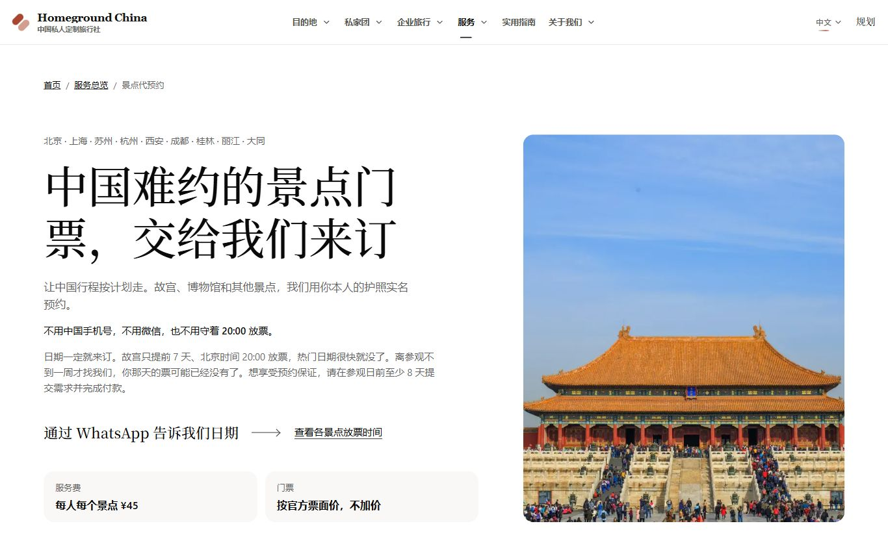
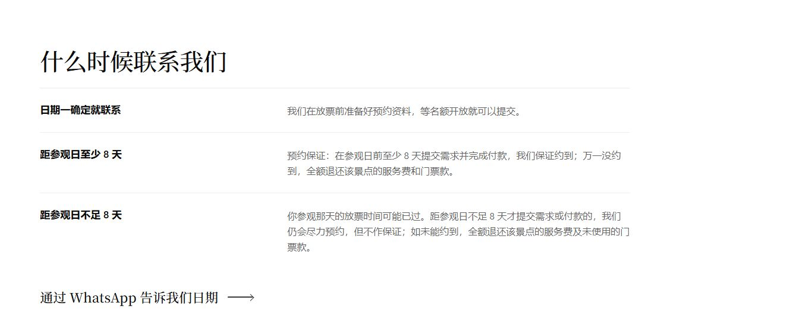
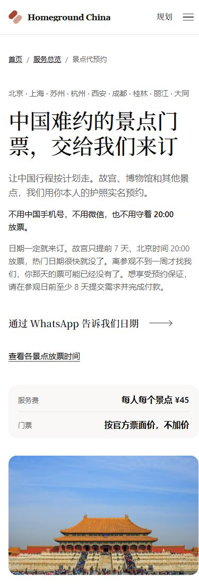
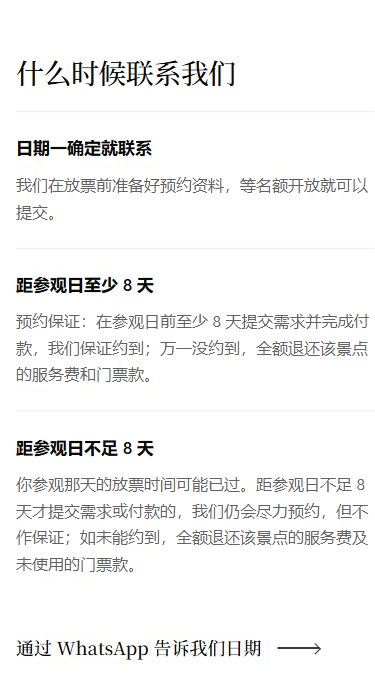

# Owner revision — 18 October 2026

The owner explicitly removed the attraction-specific “best effort” exclusion after reviewing the Chinese preview. All seven service editions and their current terms/refund pages now use the common advance-booking guarantee. The separate rule for requests or payments less than eight days ahead remains. Fees, written confirmation before payment, issued-ticket cancellation, source facts and historical accepted terms are unchanged.

Hanging Temple keeps its source-backed daily quota, face-verification information and full-refund description. The table, form and prepared message no longer add an exclusion label; its guide CTA uses the same booking path as other offered attractions.

Validation: production build and TypeScript passed; 53 focused reservation and service-edition tests passed. The Chinese page was refreshed in the existing in-app preview, checked at 1366×900 and 390×844 without horizontal overflow. Screenshots below are crops from full-page browser captures at those viewport sizes (the phone capture excludes the 15px scrollbar, leaving 375px of page pixels); no text or page content was altered. The privacy banner was dismissed using its necessary-only button. No enquiry was sent.

The initial 17 October comparison gallery is historical. These images supersede its exception wording.

## Desktop — 1366×900

## Phone — 390×844

